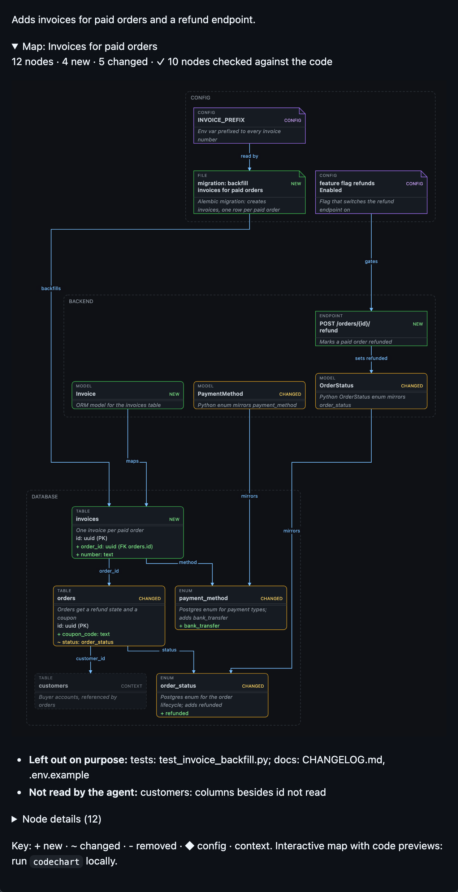
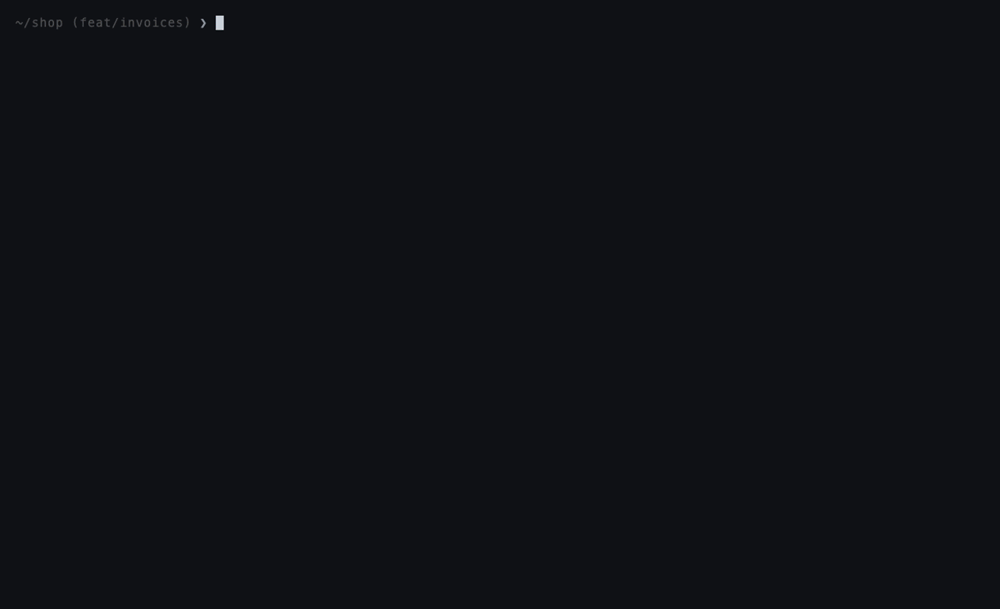

<h1 align="center"> codechart</h1>

<p align="center">
  <b>See the shape of a change before you read it.</b><br>
  A skill for AI coding agents that turns their plans and change summaries into maps and flowcharts — checked against your code.
</p>

<p align="center">
  <a href="https://www.npmjs.com/package/codechart"></a>
  <a href="https://github.com/freeleex/codechart/actions/workflows/ci.yml"></a>
  <a href="https://skills.sh/freeleex/codechart"></a>
  
  <a href="LICENSE"></a>
</p>

<p align="center">
  <a href="#install">Install</a> · <a href="#what-you-get">What you get</a> · <a href="#why-you-can-trust-the-diagram">Trust</a> · <a href="#cost">Cost</a> · <a href="docs/configuration.md">Configure</a> · <a href="docs/README.md">Docs</a>
</p>

<p align="center">
  
</p>

---

## The problem

Your agent just finished a change. Its summary reads like this:

> Done. Migration `0042` adds `coupon_code` to `orders` and changes `orders.status`; adds `refunded` to the `order_status` enum and `bank_transfer` to `payment_method`; creates `invoices` (`order_id`, `method`, `number`) and backfills one invoice per paid order, numbered from `INVOICE_PREFIX`. `OrderStatus` and `PaymentMethod` mirror the new enum values; new `Invoice` model. `POST /orders/{id}/refund` sets `OrderStatus.REFUNDED`, gated by `refundsEnabled`. Didn't read `customers` beyond its id. Tests in `test_invoice_backfill.py`; updated `CHANGELOG.md` and `.env.example`.

Every word is correct, and you still don't *see* it. Which of those are new, and which already existed? What does `invoices` point at? What does the flag actually gate? You open the diff and trace it by hand. On a 20-file change, that's where your review time goes.

## The fix

With codechart, the same reply starts with this:

**Map** _(key: + new  ~ changed  - removed  ◆ config · unmarked = unchanged)_
```diff
database
~ orders ─customer_id─▶ customers
         ─status──────▶ enum order_status
+ invoices ─order_id─▶ orders
           ─method───▶ enum payment_method
~ enum order_status
~ enum payment_method

backend
~ model OrderStatus ─mirrors─▶ enum order_status
+ model Invoice ─maps─▶ invoices
+ endpoint POST /orders/{id… ─sets refunded─▶ model OrderStatus
~ model PaymentMethod ─mirrors─▶ enum payment_method

config
+ migration: backfill invoi… ─backfills─▶ invoices
◆ INVOICE_PREFIX ─read by─▶ migration: backfill invoices for paid orders
◆ feature flag refundsEnabl… ─gates─▶ endpoint POST /orders/{id}/refund

12 nodes · 4 new · 5 changed · 2 config · ✓ 10 checked
gaps: customers: columns besides id not read
not on map: tests: test_invoice_backfill.py · docs: CHANGELOG.md, .env.example
```

Open full map

New things are `+`, changed ones `~`, removed ones `-`, config `◆`; anything unmarked already existed. The block is a `diff` fence, so Claude Code, OpenCode, Codex, Gemini CLI, Cursor and GitHub colour the new and removed lines on their own. Layers are grouped, every relation is drawn, and `✓ 10 checked` means each claim on the map was verified against your files and the git diff. It takes ten seconds to read, and `gaps` tells you what the agent *didn't* look at.

**Open full map** opens an interactive page. Click any node for its summary, file, fields — and in a change summary, its diff, read straight from git:


You don't need to ask for any of this. The skill fires when the agent summarizes changes, writes a plan, or explains how code behaves, and stays quiet for typo fixes.

## Install

```bash
npm i -g codechart && codechart install-skill
```

That's it. Open your coding agent in any repo and try:

```text
> summarize the uncommitted changes
> plan adding refunds to orders
> show me the flow of accepting an invite
```

Works with Claude Code, Codex, Gemini CLI, GitHub Copilot, Cursor, OpenCode and any other agent that supports [Agent Skills](https://agentskills.io). `install-skill` asks which agents get the skill, and adds a reminder line, a Claude Code hook and an OpenCode plugin so agents don't forget it in long sessions. `codechart update` brings everything up to date (what changed: [CHANGELOG.md](CHANGELOG.md)), and codechart tells you once a day when there's a new version. No diagram appeared? `codechart doctor` checks the setup (`--fix` repairs it, `--last` explains the last turn). Details, other agents, updating and uninstalling: [Install and agents](docs/install.md).

## What you get

### Flows: what the code actually does

Ask "how does this work?", "what are the edge cases?" or "walk me through the logic" and you get a **flow**: decisions, edge cases and outcomes, drawn only if the agent saw them in the code. Branches it didn't verify go under `gaps` instead of being drawn.

**Flow** _(key: + new  ~ changed  ? planned  ◇ decision  ⤷ shared step)_
```text
Accept a team invite
────────────────────
+look up invite by token
◇ +invite found?
├─ no  → +404 invite not found
└─ yes → ◇ +expired?
         ├─ yes → +410 invite expired
         └─ no  → ◇ +already a member?
                  ├─ yes → +return already a member
                  └─ no  → +save membership → +return joined

9 steps · 9 new · 0 changed · 0 planned · ✓ 15 anchors checked
gaps: did not check what happens when two requests accept the same invite at
      once
```

Every step and branch is anchored to a `file:line` or a quoted line, and the render fails if the line doesn't exist. On the full page, clicking a step shows the exact code behind it and each branch:


### Plans: Now and After, side by side

Maps and flows work for **plans** too, so you can catch a wrong design before any code exists. A plan that touches existing code opens as **Now** and **After plan**: same positions in both panes, panning together (the header's *Panes: linked* toggle sets them free). What the plan removes is red in Now; what it adds is green (maps) or dashed (flows).


A plan that changes existing behaviour gets the same treatment as a flow — the dropped branch red on the left, the planned one dashed on the right:


### Infrastructure maps

Terraform, OpenTofu, Helm, Kustomize and Kubernetes changes get a map of resources, modules and what they reference — built in, no rule to write:

**Map** _(key: + new  ~ changed  - removed  ◆ config · unmarked = unchanged)_
```diff
storage
+ aws_s3_bucket.logs
+ aws_s3_bucket_lifecycle_c… ─bucket──────────▶ aws_s3_bucket.logs
                             ─expiration.days─▶ var.log_retention_days

network
~ aws_lb.api ─access_logs.bucket─▶ aws_s3_bucket.logs
             ─subnets────────────▶ module.vpc

config
◆ var.log_retention_days

5 nodes · 2 new · 1 changed · 1 config · ✓ 5 checked
gaps: terraform plan not run · module.vpc internals not read
```

On the full page, a changed resource shows its HCL diff and changed attributes (light theme here; every page has light, dark and auto):


### Terminal first, page when it helps

Small diagrams stay in the reply. Big ones also get a self-contained HTML page: zoom, pan, light and dark themes, a node panel with back/forward through the nodes you opened and a *Used by* / *Uses* list of the node's links (selecting a node dims all but it and its neighbours; Esc clears), a row of status chips under the header that count, explain and fade nodes (*Δ changes only* hides the context), nothing loaded from the internet. In a change summary, a node's diff is read from git when the page is built, so the agent spends no tokens on it (lockfiles, minified bundles, `dist/` and files marked `linguist-generated` are skipped). Each node's panel shows the whole diff (up to 1000 lines per file) as foldable hunks in a GitHub-style layout (full-row red/green tints, line numbers, long unchanged runs collapsed into a click-to-open row), a tickbox left of the panel title to mark the node reviewed (*7/12 reviewed* in that row, *Next unreviewed*; a tick lasts until the node's diff changes) a pager bar (‹ 3 / 10 ›, *+ all* / *− all*) and keys: `n`/`p` hunks (open one, fold the rest; every hunk starts folded), `f` zoom to the selected node (also a ◎ button next to the panel's ← →; the selected node has a blue glow, so you can tell it from its lit neighbours), `]`/`[` unreviewed nodes, `r` reviewed, `o`/`O` fold, `?` help.

### Maps in pull requests

Reviewers get the map too. Turn it on once per repo (`codechart setup-pr-maps`, or ask your agent): it shows the CI file and asks before writing anything. From then on, PR and MR descriptions the agent writes end with a collapsed map, and CI redraws it on every push, so new ✗ flags appear when the code moves on. No AI or tokens in CI. [How it works and setup for GitHub and GitLab](docs/pr-maps.md).



### Review in your terminal

Prefer the console to the page? `codechart review` opens the newest map of your branch in your `$EDITOR` as a coloured diff, one heading per node. Write `> text` under a node or a diff line for a comment, `>? text` for a question, `>del text` for "delete this", save and quit. Then tell your agent "review done": it runs `codechart feedback --take` and gets your notes as numbered markdown, each with its file, line and the code it points at. `codechart comment <node>[:<path>:<line>] <text>` adds one note without the editor. Works for maps shown only in the terminal too. Notes stay with the map when your agent redraws it on the same branch (same title), and turn *outdated* where the node's diff has changed. [Commands](docs/cli.md#console-review).



### When it fires, and when it stays quiet

The skill fires when the agent summarizes a change, writes a plan or explains how code behaves. Built-in rules decide: migrations and models, infrastructure files, 3+ related files (map), 2+ decisions or edge cases (flow). One-file text, comment, formatting or version-bump changes are skipped. Your own rules in `.codechart.yaml` run first: [Configuration](docs/configuration.md).

## Why you can trust the diagram

- **The agent writes data, codechart draws.** LLMs misalign hand-drawn ASCII, so the agent only describes nodes and links as JSON. Layout is code.
- **Map claims are checked.** Each node's file must exist, a quoted line must be in it, and in a change summary every new, changed or removed node must be in the git diff (`--git`, `--since <base>`, `--commit <sha>`). When everything matches, the footer says `✓ 10 checked`. When it doesn't, the output opens with the mismatch — straight from a render where the agent claimed an untouched table changed:

  ```text
  ✗ 1 claim doesn't match the code: ~customers not in diff
  ```

  The agent is told to fix its spec, or to keep the `✗` and own up when the change really differs from its summary. `--strict` turns mismatches into a non-zero exit.
- **Plan vs built.** A plan rendered in a git repo is kept for a week (per branch, in the cache folder). The change summary after it is compared with it: what was planned and not built, built and not planned, or built differently, each with the reason the agent noted (`drift` in the spec), else `✗ … no reason given`. `--strict` fails on unexplained drift:

  ```text
  Plan vs built (plan "Users can belong to teams", drawn 2h ago)
  − audit log  in the plan, not built · why: left for later
      “You said the audit log can wait for the next release, so it was left out.”
  ✗ team_id index  built differently (path src/index.ts → src/team-index.ts) · no reason given
  ```

  The HTML page marks the nodes and steps that differ with a `◆`, explains each in a plain-words comparison box in its panel (what the plan said, what was built, and the agent's reason one click away), lists them in its info panel, and draws what was planned and not built as a dashed ghost labelled `NOT BUILT`.
- **Nothing left off quietly.** With a diff, every changed file must sit under a node's path or be named in *Not on map* (lockfiles and generated files excepted), else `✗ 1 changed file not on map: src/x.ts`. A summary rendered without a diff says `diff not checked` instead of looking verified.
- **Flows are anchored to real code.** Every step that exists in code names its `file:line` or quotes the line. If the line doesn't exist, the render fails and the agent has to fix it. For a commit that isn't checked out, `--at <rev>` reads anchors from that revision.
- **Gaps are explicit.** Whatever the agent didn't read is listed under `gaps`, not guessed.
- **Validated input.** Specs are checked against a schema, with clear errors the agent can act on.

## Cost

A diagram is about **2–3 extra API calls**. In a long session that's roughly 2–3% of your usage per diagram, and nothing for trivial changes. That's an estimate from Claude Code sessions with Sonnet; other agents and models will differ, and shorter sessions pay proportionally more. Measured runs are in [docs/efficiency.md](docs/efficiency.md).

The CLI is small: a 112.2 kB package, 5 runtime dependencies, and a cold start around 150 ms.

## Safe to run

- No telemetry, no shell: only read-only `git` and your OS opener. The only network calls are a once-a-day version check to npm, plus a read of the changelog from GitHub when there's a newer one ([off with one setting](docs/install.md#updating)) and opt-in [PR maps](docs/pr-maps.md), whose CI job edits the PR description and publishes the map image.
- HTML pages load nothing external, all text is escaped, and they're saved to `~/.cache/codechart`, never to your repo. A summary page holds your diff: share it only where you'd share the diff.
- Audited before release across 8 areas, including untrusted repos and prompt-injected specs: [SECURITY.md](SECURITY.md) and [docs/security-review.md](docs/security-review.md).

## Configure

Works with zero config. `codechart init` writes a commented `.codechart.yaml` for your own rules ("always map `app/models/**`", "draw a flow for API changes"), and `codechart config` shows what's in effect. Every key: [Configuration](docs/configuration.md). Every command: [CLI](docs/cli.md).

## FAQ

**Will it draw a diagram for every tiny change?**
No. One-file text, comment, formatting or version-bump changes are skipped. Flows only appear for logic with 2+ decisions or edge cases, or when you ask for one.

**Does my code leave my machine?**
Not because of codechart. The diagram is built from what your agent already read, and the daily version check sends nothing but the request for the newest version number. Only with [PR maps](docs/pr-maps.md) on does CI send the map image and description to your own GitHub or GitLab, where the PR already lives.

**Where do the HTML pages go?**
`~/.cache/codechart`. It keeps the newest 20 per repo, plus anything under 7 days old.

More questions (permissions prompts, editors that open HTML as text, agents not on the list): [Install and agents](docs/install.md). All docs: [docs/](docs/README.md).

## License

MIT. Depends on elkjs (EPL-2.0): see [THIRD_PARTY_NOTICES.md](THIRD_PARTY_NOTICES.md).
