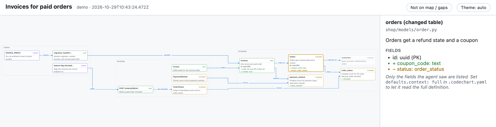
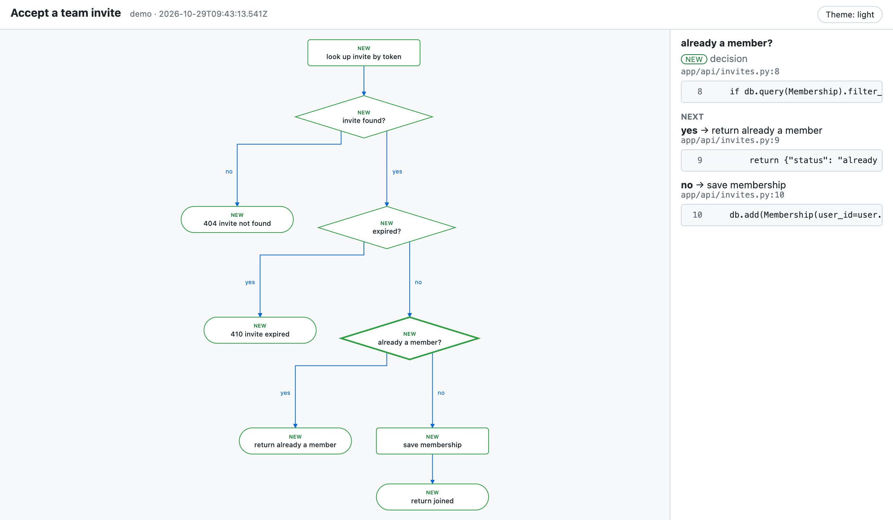

<h1 align="center">codechart</h1>

<p align="center">
  <b>See the shape of a change before you read it.</b><br>
  A skill for AI coding agents that turns their plans and change summaries into maps and flowcharts.
</p>

<p align="center">
  <a href="https://www.npmjs.com/package/codechart"></a>
  <a href="https://github.com/freeleex/codechart/actions/workflows/ci.yml"></a>
  
  <a href="LICENSE"></a>
</p>

<p align="center">
  <a href="#install">Install</a> · <a href="#what-you-get">What you get</a> · <a href="#why-you-can-trust-the-diagram">Trust</a> · <a href="#cost">Cost</a> · <a href="#configure">Configure</a> · <a href="#faq">FAQ</a>
</p>

---

## The problem

Your agent just finished a change. Its summary reads like this:

> Done. Migration `0042` adds `coupon_code` to `orders` and changes `orders.status`; adds `refunded` to the `order_status` enum and `bank_transfer` to `payment_method`; creates `invoices` (`order_id`, `method`, `number`) and backfills one invoice per paid order, numbered from `INVOICE_PREFIX`. `OrderStatus` and `PaymentMethod` mirror the new enum values; new `Invoice` model. `POST /orders/{id}/refund` sets `OrderStatus.REFUNDED`, gated by `refundsEnabled`. Didn't read `customers` beyond its id. Tests in `test_invoice_backfill.py`; updated `CHANGELOG.md` and `.env.example`.

Every word is correct, and you still don't *see* it. Which of those are new, and which already existed? What does `invoices` point at? What does the flag actually gate? You open the diff and trace it by hand. On a 20-file change, that's where your review time goes.

## The fix

With codechart, the same reply starts with this:

```text
Map (key: + new  - removed  ~ changed  · context  ◆ config)

database
  ~orders ─customer_id─▶ ·customers
          ─status──────▶ ~enum order_status
  +invoices ─order_id─▶ ~orders
            ─method───▶ ~enum payment_method

backend
  ~OrderStatus ─mirrors─▶ ~enum order_status
  +Invoice ─maps─▶ +invoices
  +POST /orders/{id}/refund ─sets refunded─▶ ~model OrderStatus
  ~PaymentMethod ─mirrors─▶ ~enum payment_method

config
  +migration: backfill invoices for p… ─backfills─▶ +invoices
  ◆INVOICE_PREFIX ─read by─▶ +migration: backfill invoices for paid orders
  ◆feature flag refundsEnabled ─gates─▶ +endpoint POST /orders/{id}/refund

12 nodes · 4 new · 5 changed · 2 config
gaps: customers: columns besides id not read
not on map: tests: test_invoice_backfill.py · docs: CHANGELOG.md, .env.example

Open full map
```

New things are `+`, changed ones `~`, existing ones `·`, config `◆`. Layers are grouped and every relation is drawn. It takes ten seconds to read, and it tells you what the agent *didn't* look at.

**Open full map** opens an interactive page with the whole picture. Click any node for its summary, file and fields, with changes marked:



Ask how something works and you get a **flow** instead. Every step points at the code that implements it:

```text
Flow (key: + new  ~ changed  ? planned  ◇ decision  ⤷ shared step)

Accept a team invite
────────────────────
+look up invite by token
◇ +invite found?
├─ no  → +404 invite not found
└─ yes → ◇ +expired?
         ├─ yes → +410 invite expired
         └─ no  → ◇ +already a member?
                  ├─ yes → +return already a member
                  └─ no  → +save membership → +return joined

9 steps · 9 new · 0 changed · 0 planned
gaps: did not check what happens when two requests accept the same invite at
      once

Open full map
```

Its full page shows the exact code behind each step. Click any step:



You don't need to ask for it. The skill fires when the agent summarizes changes, writes a plan, or explains how code behaves, and stays quiet for typo fixes.

## Install

```bash
npm i -g codechart && codechart install-skill
```

That's it. Open your coding agent in any repo and try:

```text
> summarize the uncommitted changes
> plan adding refunds to orders
> show me the flow of accepting an invite
```

Needs Node 22.12+. `install-skill` finds the agents you use and asks which ones get the skill. Existing installs are skipped (`--force` updates them). Skip the question with `--agent codex,gemini`, or use `--dir <skills folder>` for anything else.

**Works with** any agent that supports [Agent Skills](https://agentskills.io): Codex, Gemini CLI, GitHub Copilot, Cursor, OpenCode, Goose, Amp, Windsurf, Cline, Roo Code, Kiro, Junie, Factory Droid and Claude Code.

## What you get

### Maps: what changed and how it connects

Tables, columns, enums, models, endpoints, components, config and env vars, grouped by layer and marked as new, changed, context or config. They work for **plans** too, so you can catch a wrong design before any code exists.

### Flows: what the code actually does

Decisions, edge cases and outcomes, each pointing at the source lines that implement it. Branches the agent didn't verify go under `gaps` instead of being drawn.

### Terminal first, page when it helps

Small diagrams stay in the reply. Big ones, or rules you mark `output: both`, also get the self-contained HTML page: zoom, pan, light and dark themes, nothing loaded from the internet.

## Why you can trust the diagram

- **The agent writes data, codechart draws.** LLMs misalign hand-drawn ASCII, so the agent only describes nodes and links. Layout is code.
- **Flows are anchored to real code.** Every step that exists in code names its `file:line` or quotes the line. If the line doesn't exist, the render fails and the agent has to fix it.
- **Gaps are explicit.** Whatever the agent didn't read is listed under `gaps`, not guessed.
- **Validated input.** Specs are checked against a schema, with clear errors the agent can act on.

## Cost

A diagram is about **2–3 extra API calls**. In a long session that's roughly 2–3% of your usage per diagram, and nothing for trivial changes. That's an estimate from Claude Code sessions with Sonnet; other agents and models will differ, and shorter sessions pay proportionally more. Measured runs are in [docs/efficiency.md](docs/efficiency.md).

The CLI is small: a 46.5 kB package, 5 runtime dependencies, and a cold start around 150 ms.

## Safe to run

- No network calls, no telemetry.
- No shell: only read-only `git` and your OS opener, called with argument arrays.
- HTML pages load nothing external, and all text is escaped. They're saved to `~/.cache/codechart`, never to your repo.
- Audited before release across 8 areas, including untrusted repos and prompt-injected specs. See [docs/security-review.md](docs/security-review.md) and [SECURITY.md](SECURITY.md).

## Configure

Works with zero config. To tune it, run `codechart init` to write a commented `.codechart.yaml`, then add rules for your repo:

```yaml
rules:
  - name: models
    paths: ["app/models/**"]   # always map model changes
    output: both               # terminal + HTML page
    context: full              # may read referenced definitions
  - name: frontend-models
    when: "a frontend data model, store, or shared API type changed"
  - name: api-flows
    diagram: flow
    paths: ["app/api/**"]
```

`codechart config` shows the config in effect and where each value comes from.

<details>
<summary><b>All config keys</b></summary>

Repo `.codechart.yaml` and global `~/.config/codechart/config.yaml`. Editor schema: `codechart schema --config` or `config.schema.json`.

| Key | Values | Default |
|---|---|---|
| `defaults.output` | `auto`, `cli`, `web`, `both`, `none` | `auto` (terminal map; HTML only when the map is too big) |
| `defaults.context` | `short` (map what the agent already read), `full` (may read referenced definitions) | `short` |
| `defaults.flows` | `auto` (2+ decisions or edge cases), `always`, `request` | `auto` |
| `defaults.terminalMaxNodes` | number | `15` |
| `web.theme` | `auto`, `light`, `dark` | `auto` |
| `web.minNodes` | HTML from this many nodes on | `8` |
| `useBuiltinRules` | built-in migration/model path rules, `related-files`, `behaviour-flow` | `true` |
| `rules` | your own, run before the built-ins | none |

Global only: `web.outDir` (`~/.cache/codechart`), `web.keep` (`20`), `web.maxAgeDays` (`7`), `web.open` (`auto`: new pages open in your browser when running inside a VS Code-based editor; `always`, `never`).

Rules have a `name` plus exactly one of `paths` (globs: `*`, `**`, `?`, `[..]`; no braces) or `when` (a sentence the agent judges). Optional: `output`, `context` (map rules), `diagram: map|flow`. Per diagram type and file, the first matching path rule wins. `output: none` excludes files.

</details>

<details>
<summary><b>CLI commands</b> (the skill calls these; you rarely need to)</summary>

| Command | Purpose |
|---|---|
| `codechart check` | Which rules apply to changed files. `--files <csv>`, `--git`, `--commit <sha>`, `--since <base>` (+ `--head <ref>`), `--matched <csv>` |
| `codechart render <spec>` | Render a spec (JSON file or `-` for stdin). `--output auto\|cli\|web\|both`, `--theme auto\|light\|dark`, `--open`, `--md`, `--at <rev>` |
| `codechart schema` | Spec JSON schema; `--flow` for flow specs, `--config` for the config file |
| `codechart config` | Config in effect and where each value comes from (`--json`) |
| `codechart init` | Write a commented starter `.codechart.yaml` at the git root (`--force` to overwrite) |
| `codechart install-skill` | Install the skill for the agents found in your home folder. `--agent <names>`, `--dir <path>`, `--force` to overwrite |

</details>

## FAQ

**My agent isn't on the list.**
If it loads `SKILL.md` skills, run `codechart install-skill --dir <its skills folder>`. If not, the CLI still works for any agent that can run a command and write JSON: point it at `codechart schema` and `codechart render`.

**Will it draw a diagram for every tiny change?**
No. One-file text, comment, formatting or version-bump changes are skipped. Flows only appear for logic with 2+ decisions or edge cases, or when you ask for one.

**Does my code leave my machine?**
Not because of codechart. It makes no network calls. The diagram is built from what your agent already read.

**Where do the HTML pages go?**
`~/.cache/codechart`. It keeps the newest 20 per repo, plus anything under 7 days old.

**I use VS Code, Cursor, Windsurf or Antigravity, and "Open full map" shows HTML source.**
Those editors open file links as text. codechart detects them and opens new pages in your browser instead. Turn it off with `web.open: never` in `~/.config/codechart/config.yaml`.

## License

MIT. Depends on elkjs (EPL-2.0): see [THIRD_PARTY_NOTICES.md](THIRD_PARTY_NOTICES.md).
