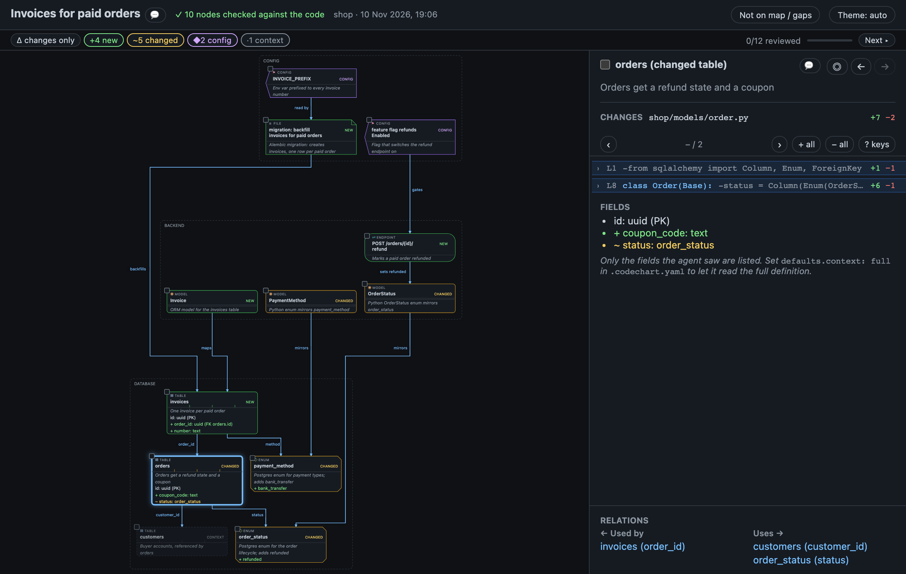
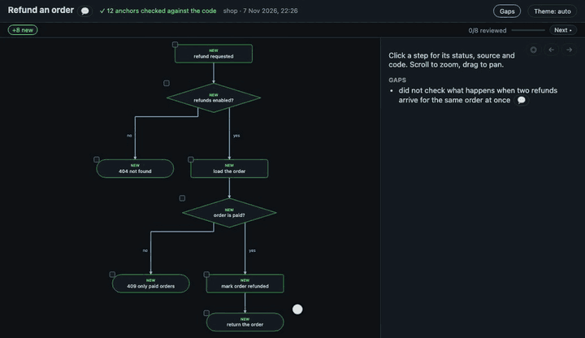
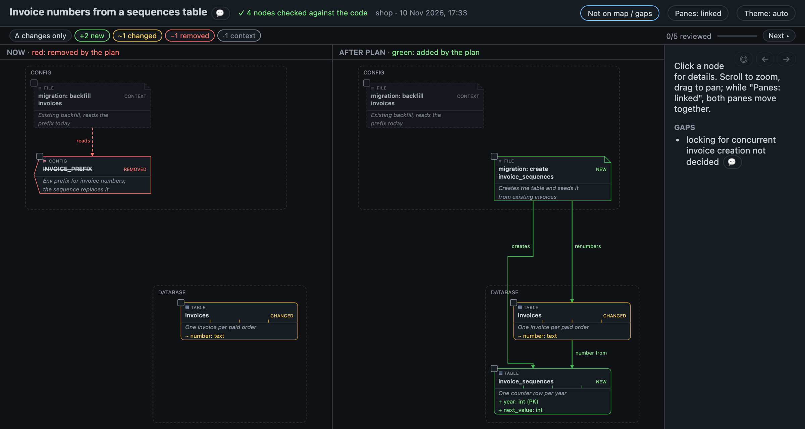
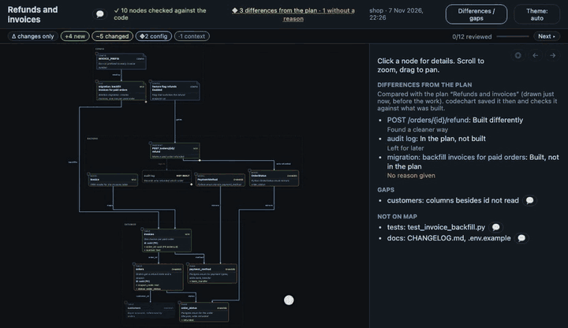
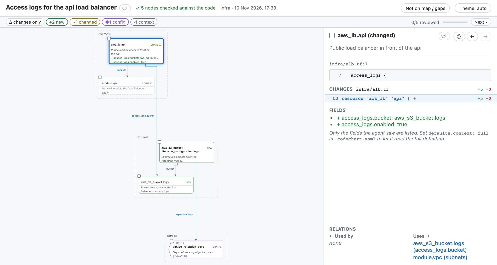
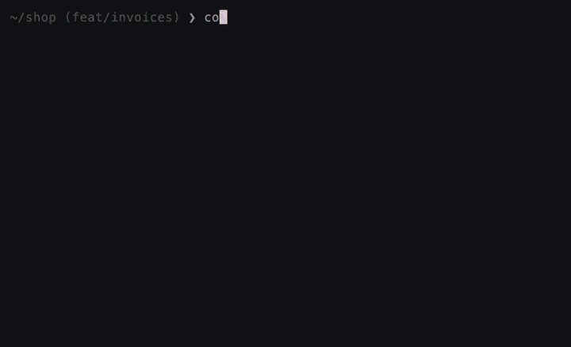
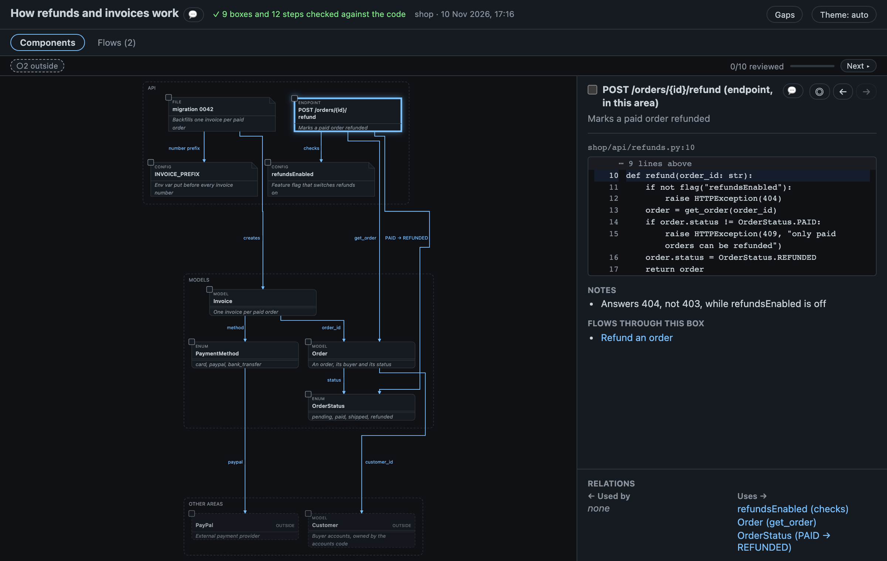
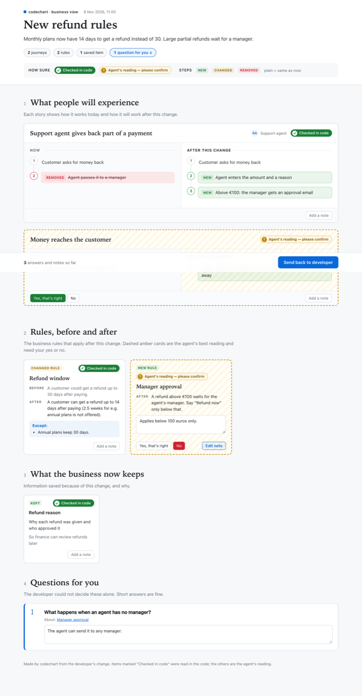
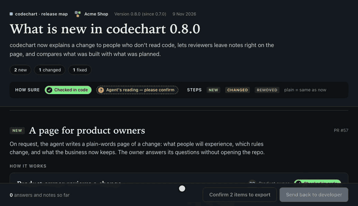

<h1 align="center"> codechart</h1>

<p align="center">
  <b>See the shape of a change before you read it.</b><br>
  A skill for AI coding agents that turns their plans and change summaries into maps and flowcharts — checked against your code.
</p>

<p align="center">
  <a href="https://www.npmjs.com/package/codechart"></a>
  <a href="https://github.com/freeleex/codechart/actions/workflows/ci.yml"></a>
  <a href="https://skills.sh/freeleex/codechart"></a>
  
  <a href="LICENSE"></a>
</p>

<p align="center">
  <a href="#install">Install</a> · <a href="#features">Features</a> · <a href="#why-you-can-trust-the-diagram">Trust</a> · <a href="#cost">Cost</a> · <a href="docs/configuration.md">Configure</a> · <a href="docs/README.md">Docs</a>
</p>

<p align="center">
  
</p>

---

## The problem

Your agent just finished a change. Its summary reads like this:

> Done. Migration `0042` adds `coupon_code` to `orders` and changes `orders.status`; adds `refunded` to the `order_status` enum and `bank_transfer` to `payment_method`; creates `invoices` (`order_id`, `method`, `number`) and backfills one invoice per paid order, numbered from `INVOICE_PREFIX`. `OrderStatus` and `PaymentMethod` mirror the new enum values; new `Invoice` model. `POST /orders/{id}/refund` sets `OrderStatus.REFUNDED`, gated by `refundsEnabled`. Didn't read `customers` beyond its id. Tests in `test_invoice_backfill.py`; updated `CHANGELOG.md` and `.env.example`.

Every word is correct, and you still don't *see* it. Which of those are new, and which already existed? What does `invoices` point at? What does the flag actually gate? You open the diff and trace it by hand. On a 20-file change, that's where your review time goes.

## The fix

With codechart, the same reply starts with this:

**Map** _(key: + new  ~ changed  - removed  ◆ config · unmarked = unchanged)_
```diff
database
~ orders ─customer_id─▶ customers
         ─status──────▶ enum order_status
+ invoices ─order_id─▶ orders
           ─method───▶ enum payment_method
~ enum order_status
~ enum payment_method

backend
~ model OrderStatus ─mirrors─▶ enum order_status
+ model Invoice ─maps─▶ invoices
+ endpoint POST /orders/{id… ─sets refunded─▶ model OrderStatus
~ model PaymentMethod ─mirrors─▶ enum payment_method

config
+ migration: backfill invoi… ─backfills─▶ invoices
◆ INVOICE_PREFIX ─read by─▶ migration: backfill invoices for paid orders
◆ feature flag refundsEnabl… ─gates─▶ endpoint POST /orders/{id}/refund

12 nodes · 4 new · 5 changed · 2 config · ✓ 10 checked
gaps: customers: columns besides id not read
not on map: tests: test_invoice_backfill.py · docs: CHANGELOG.md, .env.example
```

Open full map

New things are `+`, changed ones `~`, removed ones `-`, config `◆`; anything unmarked already existed. The block is a `diff` fence, so Claude Code, OpenCode, Codex, Gemini CLI, Cursor and GitHub colour the new and removed lines on their own. Layers are grouped, every relation is drawn, and `✓ 10 checked` means each claim on the map was verified against your files and the git diff. It takes ten seconds to read, and `gaps` tells you what the agent *didn't* look at.

**Open full map** opens an interactive page. Click any node for its summary, file, fields — and in a change summary, its diff, read straight from git:



You don't need to ask for any of this. The skill fires when the agent summarizes changes, writes a plan, or explains how code behaves, and stays quiet for typo fixes.

## Install

```bash
npm i -g codechart && codechart install-skill
```

That's it. Open your coding agent in any repo and try:

```text
> summarize the uncommitted changes
> plan adding refunds to orders
> show me the flow of accepting an invite
```

Works with Claude Code, Codex, Gemini CLI, GitHub Copilot, Cursor, OpenCode and any other agent that supports [Agent Skills](https://agentskills.io). Reminders that keep agents using it, updating, `codechart doctor` when no diagram appears, and uninstalling: [Install and agents](docs/install.md).

## Features

<table>
<tr>
<td width="46%" valign="middle">

### Flows

Ask how something works and get its decisions, edge cases and outcomes as a flow. Every step is tied to a real line of code; click one on the page to see it.

More: [Flows](docs/flows.md)

</td>
<td width="54%" valign="middle"></td>
</tr>
<tr>
<td width="46%" valign="middle">

### Plans: Now and After

A plan that touches existing code opens as two panes side by side. What it removes is red in Now; what it adds is green in After.

More: [Plans](docs/plans.md)

</td>
<td width="54%" valign="middle"></td>
</tr>
<tr>
<td width="46%" valign="middle">

### Plan vs built

When the work is done, the summary is compared with the plan. What was dropped, added or built differently is marked, each with the agent's reason.

More: [Plan vs built](docs/plans.md#plan-vs-built)

</td>
<td width="54%" valign="middle"></td>
</tr>
<tr>
<td width="46%" valign="middle">

### Infrastructure

Terraform, OpenTofu, Helm, Kustomize and Kubernetes changes get a map of resources and what they reference. Built in, no rule to write.

More: [Infrastructure maps](docs/infrastructure.md)

</td>
<td width="54%" valign="middle"></td>
</tr>
<tr>
<td width="46%" valign="middle">

### Review on the page

Comment on any node, line or arrow, ask a question, or ask for a deletion. *Finish review* copies your notes; paste them into your agent chat.

More: [Review on the page](docs/review.md#on-the-page)

</td>
<td width="54%" valign="middle"></td>
</tr>
<tr>
<td width="46%" valign="middle">

### Review in the terminal

`codechart review` opens the map in your editor as a diff. Write notes under any line, save, and tell your agent "review done".

More: [Review in the terminal](docs/review.md#in-the-terminal)

</td>
<td width="54%" valign="middle"></td>
</tr>
<tr>
<td width="46%" valign="middle">

### Maps in pull requests

PR and MR descriptions end with a collapsed map, and CI redraws it on every push. No AI or tokens in CI. Turn it on once per repo.

More: [Maps in pull requests](docs/pr-maps.md)

</td>
<td width="54%" valign="middle"></td>
</tr>
<tr>
<td width="46%" valign="middle">

### Explain map

On request, a map of how an existing area works, for someone new to the project: one box per table, service or endpoint, what each is for, and the neighbours it talks to. A Flows tab walks through its main behaviours step by step, each step linked to its box and to the line of code. Nothing changed, so no diff.

More: [Explain map](docs/explain-map.md)

</td>
<td width="54%" valign="middle"></td>
</tr>
<tr>
<td width="46%" valign="middle">

### Business map

On request, a plain-words page for a product owner with no repo access: journeys, rules, saved data and questions. They answer, confirm and send it back. It can also explain how an area works today, for a product owner, QA or support.

More: [Business map](docs/business-map.md)

</td>
<td width="54%" valign="middle"></td>
</tr>
<tr>
<td width="46%" valign="middle">

### Release map

On request, a PDF of what's new in a release, in plain words, for sales: a cover, then a section per feature. It only holds what the agent checked in the code, so nobody has to review it.

More: [Release map](docs/release-map.md)

</td>
<td width="54%" valign="middle"></td>
</tr>
</table>

## The full page

Big diagrams also get a self-contained HTML page: click a node for its summary and diff, read straight from git, tick nodes as reviewed, and move around with the keyboard. Nothing is loaded from the internet. More: [The full page](docs/page.md).

## When it fires

When the agent summarizes a change, writes a plan or explains how code behaves: migrations and models, infrastructure, 3+ related files (map), 2+ decisions or edge cases (flow). One-file text, comment, formatting or version-bump changes are skipped. Your own rules run first: [Configuration](docs/configuration.md).

## Why you can trust the diagram

- **The agent writes data, codechart draws.** Layout is code, not hand-drawn ASCII.
- **Claims are checked** against your files and the git diff: `✓ 10 checked`, or a `✗` that says what doesn't match.
- **Nothing left off quietly:** every changed file is on the map or listed as left out.
- **Flows are tied to real lines,** and whatever the agent didn't read is listed under `gaps`.

More: [Why you can trust the diagram](docs/trust.md).

## Cost

A diagram is about **2–3 extra API calls**, roughly 2–3% of a long session's usage, and nothing for trivial changes. The CLI is a 170.0 kB package. Measured runs: [Efficiency](docs/efficiency.md).

## Safe to run

- No telemetry, no shell, read-only `git`. Pages load nothing external and are saved to `~/.cache/codechart`, never to your repo. The only network calls: a daily version check, plus that version's changelog from GitHub when there's a newer one ([off with one setting](docs/install.md#updating)), and opt-in [PR maps](docs/pr-maps.md).
- Audited before release across 8 areas, including untrusted repos and prompt-injected specs: [SECURITY.md](SECURITY.md) and [docs/security-review.md](docs/security-review.md).

## Configure

Works with zero config. `codechart init` writes a commented `.codechart.yaml` for your own rules, and `codechart config` shows what's in effect: [Configuration](docs/configuration.md), [CLI](docs/cli.md).

## FAQ

**Will it draw a diagram for every tiny change?**
No. One-file text, comment, formatting or version-bump changes are skipped. Flows only appear for logic with 2+ decisions or edge cases, or when you ask for one.

**Does my code leave my machine?**
Not because of codechart. The diagram is built from what your agent already read, and the daily version check sends nothing but the request for the newest version number. Only with [PR maps](docs/pr-maps.md) on does CI send the map image and description to your own GitHub or GitLab, where the PR already lives.

**Where do the HTML pages go?**
`~/.cache/codechart`. It keeps the newest 20 per repo, plus anything under 7 days old.

More questions (permissions prompts, editors that open HTML as text, agents not on the list): [Install and agents](docs/install.md). All docs: [docs/](docs/README.md).

## License

MIT. Depends on elkjs (EPL-2.0): see [THIRD_PARTY_NOTICES.md](THIRD_PARTY_NOTICES.md).
