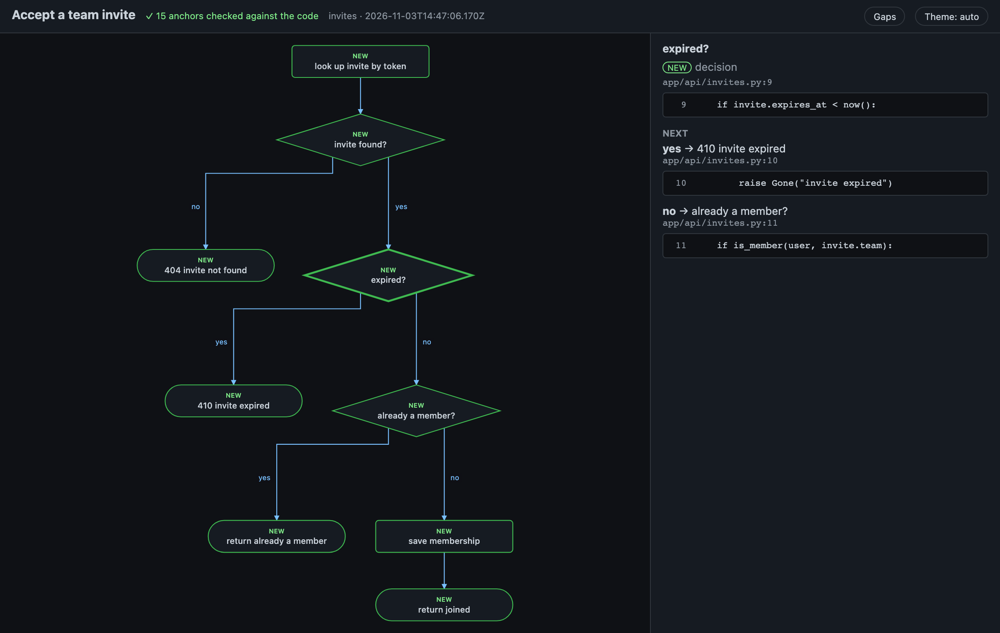
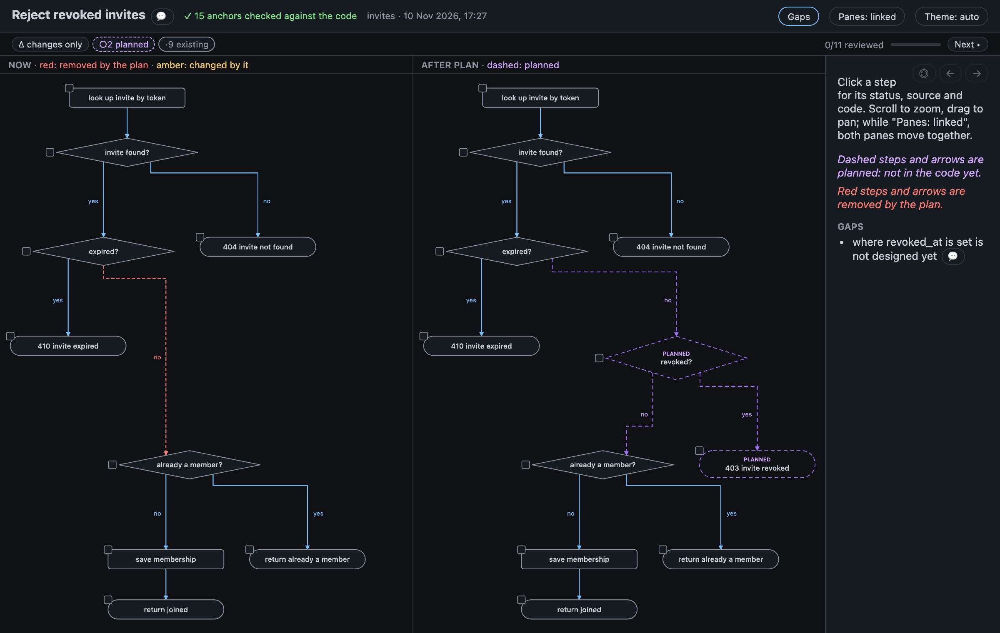

<h1 align="center"> codechart</h1>

<p align="center">
  <b>See the shape of a change before you read it.</b><br>
  A skill for AI coding agents that turns their plans and change summaries into maps and flowcharts — checked against your code.
</p>

<p align="center">
  <a href="https://www.npmjs.com/package/codechart"></a>
  <a href="https://github.com/freeleex/codechart/actions/workflows/ci.yml"></a>
  <a href="https://skills.sh/freeleex/codechart"></a>
  
  <a href="LICENSE"></a>
</p>

<p align="center">
  <a href="#install">Install</a> · <a href="#what-you-get">What you get</a> · <a href="#why-you-can-trust-the-diagram">Trust</a> · <a href="#cost">Cost</a> · <a href="#configure">Configure</a> · <a href="#faq">FAQ</a>
</p>

<p align="center">
  
</p>

---

## The problem

Your agent just finished a change. Its summary reads like this:

> Done. Migration `0042` adds `coupon_code` to `orders` and changes `orders.status`; adds `refunded` to the `order_status` enum and `bank_transfer` to `payment_method`; creates `invoices` (`order_id`, `method`, `number`) and backfills one invoice per paid order, numbered from `INVOICE_PREFIX`. `OrderStatus` and `PaymentMethod` mirror the new enum values; new `Invoice` model. `POST /orders/{id}/refund` sets `OrderStatus.REFUNDED`, gated by `refundsEnabled`. Didn't read `customers` beyond its id. Tests in `test_invoice_backfill.py`; updated `CHANGELOG.md` and `.env.example`.

Every word is correct, and you still don't *see* it. Which of those are new, and which already existed? What does `invoices` point at? What does the flag actually gate? You open the diff and trace it by hand. On a 20-file change, that's where your review time goes.

## The fix

With codechart, the same reply starts with this:

**Map** _(key: + new  ~ changed  - removed  ◆ config · unmarked = unchanged)_
```diff
database
~ orders ─customer_id─▶ customers
         ─status──────▶ enum order_status
+ invoices ─order_id─▶ orders
           ─method───▶ enum payment_method
~ enum order_status
~ enum payment_method

backend
~ model OrderStatus ─mirrors─▶ enum order_status
+ model Invoice ─maps─▶ invoices
+ endpoint POST /orders/{id… ─sets refunded─▶ model OrderStatus
~ model PaymentMethod ─mirrors─▶ enum payment_method

config
+ migration: backfill invoi… ─backfills─▶ invoices
◆ INVOICE_PREFIX ─read by─▶ migration: backfill invoices for paid orders
◆ feature flag refundsEnabl… ─gates─▶ endpoint POST /orders/{id}/refund

12 nodes · 4 new · 5 changed · 2 config · ✓ 10 checked
gaps: customers: columns besides id not read
not on map: tests: test_invoice_backfill.py · docs: CHANGELOG.md, .env.example
```

Open full map

New things are `+`, changed ones `~`, removed ones `-`, config `◆`; anything unmarked already existed. The block is a `diff` fence, so Claude Code, OpenCode, Codex, Gemini CLI, Cursor and GitHub colour the new and removed lines on their own. Layers are grouped, every relation is drawn, and `✓ 10 checked` means each claim on the map was verified against your files and the git diff. It takes ten seconds to read, and `gaps` tells you what the agent *didn't* look at.

**Open full map** opens an interactive page. Click any node for its summary, file, fields — and in a change summary, its diff, read straight from git:


You don't need to ask for any of this. The skill fires when the agent summarizes changes, writes a plan, or explains how code behaves, and stays quiet for typo fixes.

## Install

```bash
npm i -g codechart && codechart install-skill
```

That's it. Open your coding agent in any repo and try:

```text
> summarize the uncommitted changes
> plan adding refunds to orders
> show me the flow of accepting an invite
```

Needs Node 22.12+. `install-skill` finds the agents you use and asks which ones get the skill. An older codechart copy is updated; a folder holding something else is skipped (`--force` overwrites it). Skip the question with `--agent codex,gemini`, or use `--dir <skills folder>` for anything else.

**Works with** any agent that supports [Agent Skills](https://agentskills.io): Claude Code, Codex, Gemini CLI, GitHub Copilot, Cursor, OpenCode, Goose, Amp, Windsurf, Cline, Roo Code, Kiro, Junie and Factory Droid.

Already use the [skills CLI](https://skills.sh)? `npx skills add freeleex/codechart` installs the skill, but not the CLI it runs: add `npm i -g codechart` too. Pick one way to install the skill, so your agent doesn't load it twice.

### Help agents remember it

Agents load a skill only when they think of it, and in long sessions they sometimes don't. `install-skill` also adds two helpers, pre-checked in its question and on without one. `--no-reminder` / `--no-hook` leave one out; `--reminder` or `--hook` adds only that one. They cost tokens only when they work: the reminder line is about 40 tokens per session, and the hook costs nothing until it sends Claude back for a map.

- **Reminder line**: one line in your agents' global instructions file (`~/.claude/CLAUDE.md`, `~/.config/opencode/AGENTS.md`, `~/.codex/AGENTS.md`, `~/.gemini/GEMINI.md`) asking them to use codechart for changes that touch 3+ files or add branching behaviour. It sits between `<!-- codechart -->` markers; an older line there is replaced.
- **Claude Code hook** (only when Claude Code gets the skill): adds `codechart hook prompt` (UserPromptSubmit) and `codechart hook stop` (Stop) to `~/.claude/settings.json`. When a turn changed 3+ files and the reply has no diagram, Claude is asked once to follow the skill. Files you had already changed before the turn don't count.

Remove everything later with [one command](#uninstall).

## What you get

### Flows: what the code actually does

Ask "how does this work?", "what are the edge cases?" or "walk me through the logic" and you get a **flow**: decisions, edge cases and outcomes, drawn only if the agent saw them in the code. Branches it didn't verify go under `gaps` instead of being drawn.

**Flow** _(key: + new  ~ changed  ? planned  ◇ decision  ⤷ shared step)_
```text
Accept a team invite
────────────────────
+look up invite by token
◇ +invite found?
├─ no  → +404 invite not found
└─ yes → ◇ +expired?
         ├─ yes → +410 invite expired
         └─ no  → ◇ +already a member?
                  ├─ yes → +return already a member
                  └─ no  → +save membership → +return joined

9 steps · 9 new · 0 changed · 0 planned · ✓ 15 anchors checked
gaps: did not check what happens when two requests accept the same invite at
      once
```

Every step and branch is anchored to a `file:line` or a quoted line, and the render fails if the line doesn't exist. On the full page, clicking a step shows the exact code behind it and each branch:



### Plans: Now and After, side by side

Maps and flows work for **plans** too, so you can catch a wrong design before any code exists. A plan that touches existing code opens as **Now** and **After plan**: same positions in both panes, panning together (the header's *Panes: linked* toggle sets them free). What the plan removes is red in Now; what it adds is green (maps) or dashed (flows).


A plan that changes existing behaviour gets the same treatment as a flow — the dropped branch red on the left, the planned one dashed on the right:



### Infrastructure maps

Terraform, OpenTofu, Helm, Kustomize and Kubernetes changes get a map of resources, modules and what they reference — built in, no rule to write:

**Map** _(key: + new  ~ changed  - removed  ◆ config · unmarked = unchanged)_
```diff
storage
+ aws_s3_bucket.logs
+ aws_s3_bucket_lifecycle_c… ─bucket──────────▶ aws_s3_bucket.logs
                             ─expiration.days─▶ var.log_retention_days

network
~ aws_lb.api ─access_logs.bucket─▶ aws_s3_bucket.logs
             ─subnets────────────▶ module.vpc

config
◆ var.log_retention_days

5 nodes · 2 new · 1 changed · 1 config · ✓ 5 checked
gaps: terraform plan not run · module.vpc internals not read
```

On the full page, a changed resource shows its HCL diff and changed attributes (light theme here; every page has light, dark and auto):


### Terminal first, page when it helps

Small diagrams stay in the reply. Big ones, or rules you mark `output: both`, also get the self-contained HTML page: zoom, pan, light and dark themes, a resizable node panel with back/forward through the nodes you opened, *Not on map / gaps* one click away, nothing loaded from the internet. Each map is laid out top-down or left-to-right, whichever fits a laptop screen better. In a change summary, a node's diff is read from git when the page is built, so the agent spends no tokens on it.

### When it fires — and when it stays quiet

Before drawing anything, the agent runs `codechart check` on the changed files. Built-in rules cover the common cases: migrations and ORM models, infrastructure files, 3+ changed files that depend on each other (map), and changes with 2+ decisions or edge cases (flow). One-file text, comment, formatting or version-bump changes are skipped. Your own rules in `.codechart.yaml` run first — see [Configure](#configure).

## Why you can trust the diagram

- **The agent writes data, codechart draws.** LLMs misalign hand-drawn ASCII, so the agent only describes nodes and links as JSON. Layout is code.
- **Map claims are checked.** Each node's file must exist, a quoted line must be in it, and in a change summary every new, changed or removed node must be in the git diff (`--git`, `--since <base>`, `--commit <sha>`). When everything matches, the footer says `✓ 10 checked`. When it doesn't, the output opens with the mismatch — straight from a render where the agent claimed an untouched table changed:

  ```text
  ✗ 1 claim doesn't match the code: ~customers not in diff
  ```

  The agent is told to fix its spec, or to keep the `✗` and own up when the change really differs from its summary. `--strict` turns mismatches into a non-zero exit.
- **Nothing left off quietly.** With a diff, every changed file must sit under a node's path or be named in *Not on map* (lockfiles and generated files excepted), else `✗ 1 changed file not on map: src/x.ts`. A summary rendered without a diff says `diff not checked` instead of looking verified.
- **Flows are anchored to real code.** Every step that exists in code names its `file:line` or quotes the line. If the line doesn't exist, the render fails and the agent has to fix it. For a commit that isn't checked out, `--at <rev>` reads anchors from that revision.
- **Gaps are explicit.** Whatever the agent didn't read is listed under `gaps`, not guessed.
- **Validated input.** Specs are checked against a schema, with clear errors the agent can act on.

## Cost

A diagram is about **2–3 extra API calls**. In a long session that's roughly 2–3% of your usage per diagram, and nothing for trivial changes. That's an estimate from Claude Code sessions with Sonnet; other agents and models will differ, and shorter sessions pay proportionally more. Measured runs are in [docs/efficiency.md](docs/efficiency.md).

The CLI is small: a 74.2 kB package, 5 runtime dependencies, and a cold start around 150 ms.

## Safe to run

- No network calls, no telemetry.
- No shell: only read-only `git` and your OS opener, called with argument arrays.
- HTML pages load nothing external, and all text is escaped. They're saved to `~/.cache/codechart`, never to your repo.
- A summary page rendered with `--git`, `--since` or `--commit` holds your code: each changed node's panel shows the start of its diff. Share such a page only where you'd share the diff.
- The optional hook keeps, per session, the names and content hashes of your changed files in `~/.cache/codechart/turns` (removed after 7 days), never their contents.
- Audited before release across 8 areas, including untrusted repos and prompt-injected specs. See [docs/security-review.md](docs/security-review.md) and [SECURITY.md](SECURITY.md).

## Configure

Works with zero config. To tune it, run `codechart init` to write a commented `.codechart.yaml`, then add rules for your repo:

```yaml
rules:
  - name: models
    paths: ["app/models/**"]   # always map model changes
    output: both               # terminal + HTML page
    context: full              # may read referenced definitions
  - name: frontend-models
    when: "a frontend data model, store, or shared API type changed"
  - name: api-flows
    diagram: flow
    paths: ["app/api/**"]
```

`codechart config` shows the config in effect and where each value comes from.

<details>
<summary><b>All config keys</b></summary>

Repo `.codechart.yaml` and global `~/.config/codechart/config.yaml`. Editor schema: `codechart schema --config` or `config.schema.json`.

| Key | Values | Default |
|---|---|---|
| `defaults.output` | `auto`, `cli`, `web`, `both`, `none` | `auto` (terminal map; HTML only when the map is too big) |
| `defaults.context` | `short` (map what the agent already read), `full` (may read referenced definitions) | `short` |
| `defaults.flows` | `auto` (2+ decisions or edge cases), `always`, `request` | `auto` |
| `defaults.terminalMaxNodes` | number | `15` |
| `web.theme` | `auto`, `light`, `dark` | `auto` |
| `web.minNodes` | HTML from this many nodes on | `8` |
| `useBuiltinRules` | built-in migration/model/infrastructure path rules, `related-files`, `behaviour-flow` | `true` |
| `rules` | your own, run before the built-ins | none |

Global only: `web.outDir` (`~/.cache/codechart`), `web.keep` (`20`), `web.maxAgeDays` (`7`), `web.open` (`auto`: new pages open in your browser when running inside a VS Code-based editor; `always`, `never`).

Rules have a `name` plus exactly one of `paths` (globs: `*`, `**`, `?`, `[..]`; no braces) or `when` (a sentence the agent judges). Optional: `output`, `context` (map rules), `diagram: map|flow`. Per diagram type and file, the first matching path rule wins. `output: none` excludes files.

</details>

<details>
<summary><b>CLI commands</b> (the skill calls these; you rarely need to)</summary>

| Command | Purpose |
|---|---|
| `codechart check` | Which rules apply to changed files. `--files <csv>`, `--git`, `--commit <sha>`, `--since <base>` (+ `--head <ref>`), `--matched <csv>` |
| `codechart render <spec>` | Render a spec (JSON file or `-` for stdin). `--output auto\|cli\|web\|both`, `--theme auto\|light\|dark`, `--open`, `--md` (paste-ready markdown), `--at <rev>`; `--git`, `--commit <sha>`, `--since <base>` (+ `--head <ref>`) to check claims against the diff; `--strict` to exit 1 on a mismatch |
| `codechart schema` | Spec JSON schema; `--flow` for flow specs, `--config` for the config file |
| `codechart config` | Config in effect and where each value comes from (`--json`) |
| `codechart init` | Write a commented starter `.codechart.yaml` at the git root (`--force` to overwrite) |
| `codechart install-skill` | Install the skill for the agents found in your home folder. `--agent <names>`, `--dir <path>`, `--force` to overwrite a folder that isn't an older codechart copy, `--no-reminder`, `--no-hook` (or `--reminder`, `--hook` for only one) |
| `codechart uninstall` | Remove the skill, reminder lines and hooks; `--skill`, `--reminder`, `--hook` to pick some |
| `codechart hook prompt\|stop` | Run by the Claude Code hook; reads the hook's JSON on stdin |

</details>

## Uninstall

```bash
codechart uninstall && npm uninstall -g codechart
```

`codechart uninstall` removes the skill, the reminder lines and the hooks (`--skill`, `--reminder`, `--hook` to pick some). npm can't run it for you: it has no uninstall scripts since v7. Skill folders holding other files keep them.

## FAQ

**My agent isn't on the list.**
If it loads `SKILL.md` skills, run `codechart install-skill --dir <its skills folder>`. If not, the CLI still works for any agent that can run a command and write JSON: point it at `codechart schema` and `codechart render`.

**My agent asks permission for every render, even though I allowed `codechart`.**
The skill pipes the spec in with a heredoc (`codechart render --md - <<'EOF'`). In Claude Code, an allow rule like `Bash(codechart:*)` didn't cover that in our tests, so Claude Code asks before each render: approve it.

**Will it draw a diagram for every tiny change?**
No. One-file text, comment, formatting or version-bump changes are skipped. Flows only appear for logic with 2+ decisions or edge cases, or when you ask for one.

**Does my code leave my machine?**
Not because of codechart. It makes no network calls. The diagram is built from what your agent already read.

**Where do the HTML pages go?**
`~/.cache/codechart`. It keeps the newest 20 per repo, plus anything under 7 days old.

**I use VS Code, Cursor, Windsurf or Antigravity, and "Open full map" shows HTML source.**
Those editors open file links as text. codechart detects them and opens new pages in your browser instead. Where the editor doesn't allow that (Antigravity sandboxes agent commands), the reply includes the page's address to paste into your browser. Turn auto-open off with `web.open: never` in `~/.config/codechart/config.yaml`.

## License

MIT. Depends on elkjs (EPL-2.0): see [THIRD_PARTY_NOTICES.md](THIRD_PARTY_NOTICES.md).
