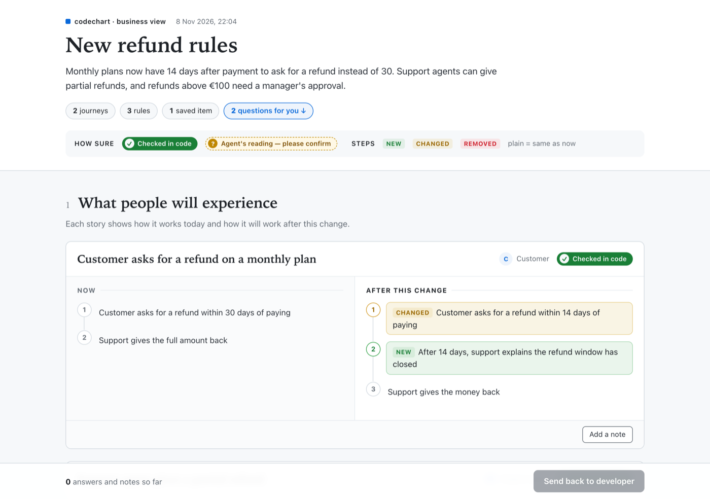

# Business map

A one-page view of a change for a product owner: what people will experience, which rules change, what the business now keeps, and a few questions only the owner can answer. No code, file names or ids on the page, and the owner needs no access to the repo.

## When to use it

When someone who doesn't read code has to sign off on a change: a new rule, a changed flow, a new kind of saved data. Your agent never makes one on its own, and it never goes into a PR description. A change of one or two files with nothing a user can see gets little from it; the agent will say so and offer a short one.

## How to ask

After the agent has mapped the change, say so in your own words:

```text
> make a business map of this for the product owner
```

The agent draws the technical map first, writes the business map from it, and replies with one line and a link to the page. Send that HTML file to the owner.



## What the owner sees

- **What people will experience:** each journey as steps today and steps after the change. New, changed and removed steps are marked.
- **Rules, before and after:** the number, the exception, the old and the new.
- **What the business now keeps:** saved information and why.
- **Questions for you:** at most seven, most important first, each tied to the journey, rule or saved item it is about.

Every item carries a tag:

- **Checked in code:** the agent read the code behind it.
- **Agent's reading, please confirm:** the agent worked it out from names and structure. The owner answers *Yes, that's right* or *No*.

The owner can type an answer under a question and add a note to any item.

## Sending it back

1. The owner presses **Send back to developer**. Their answers, yes/no verdicts and notes are copied as text.
2. They paste it into the chat or ticket where you work.
3. You paste it to your agent, which runs `codechart feedback --import --take` and reads each note with the journey, rule or saved item it belongs to, and the technical boxes behind it.

The owner can reply days later: you paste their text into any agent session in the repo. The page's saved record is kept 30 days, even after the page itself is cleaned up; after that, render the map again and send the new page. Pasting twice adds nothing new. Notes stay in the owner's browser until they send them; the page itself sends nothing.

Run `codechart feedback` yourself to see the notes: it shows the business page's when it holds notes you haven't read.

## What is checked

Before the page is drawn:

- every item links to boxes that exist on the technical map, from the latest one saved on your branch or from `codechart render --tech <spec.json>`; without either, the render stops and says to draw the technical map first;
- no sentence may look like code, a file name or path, a web address, a setting name, a secret or a technical map id.

Your agent is also told to re-read the code behind every *Checked in code* item before it draws the page. See [Why you can trust the diagram](trust.md#business-maps).

## Limits

- A link shows where to look, not that the words are right. A wrong sentence can pass every check, which is why *Checked in code* is a claim by the agent, and why the owner confirms the rest.
- HTML only: no terminal or PR version. Pages are saved in your [cache folder](configuration.md) like the others.
- Sharing the file: GitHub serves an `.html` attachment as a download and some mail filters block it. Zip it, or send it in Slack.

## Cost

An extra map per request, on Sonnet about $0.02 for a small change, $0.06 for a medium one and $0.13 for a big one.

## Related

- [Review](review.md#notes-from-a-product-owner)
- [CLI commands](cli.md)
