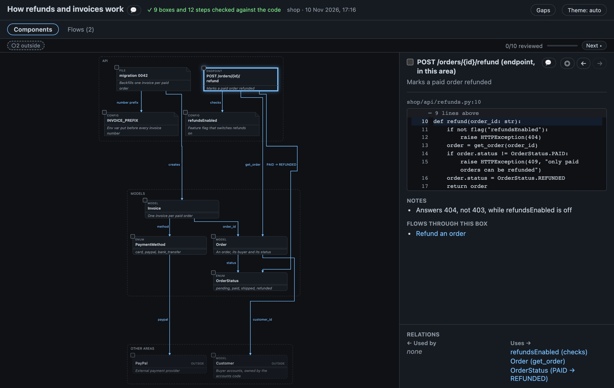
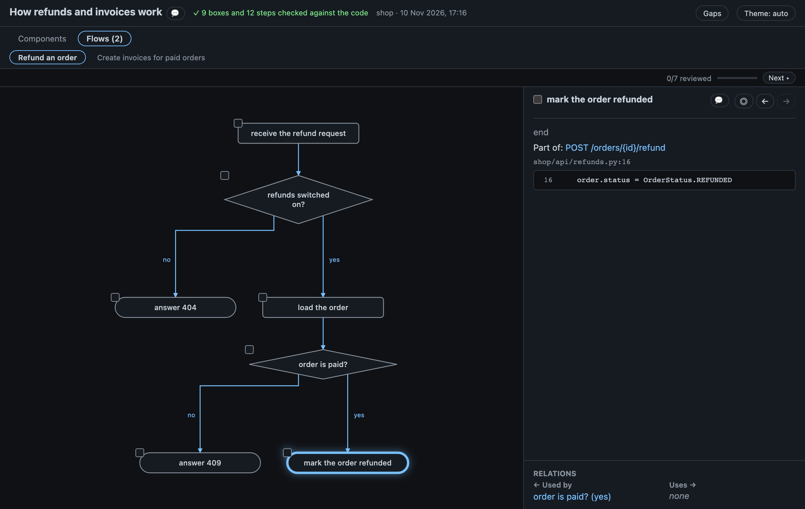
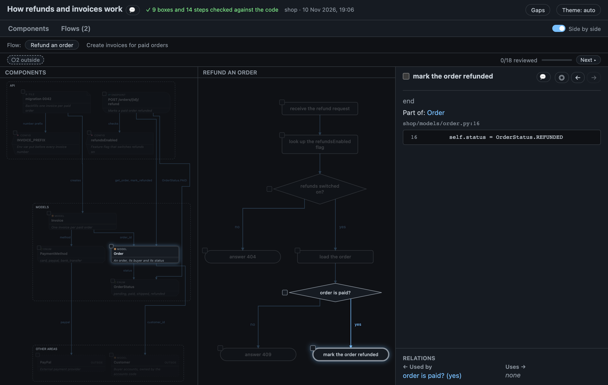

# Explain map

A map of how an existing part of the code works, for someone new to the project: what is in it, what each piece is for, and what it talks to. Nothing changed, so there is no diff and no change marks.

## When to use it

When you need to understand code that is already there: onboarding on a module, picking up a feature someone else wrote, or checking what an area touches before you change it. It is for one area at a time. For one behaviour on its own, ask for a [flow](flows.md); for a change, the normal map. The map carries its main behaviours itself, as a Flows tab.

## How to ask

```text
> explain how billing works
> map of the billing module
> onboard me on the checkout code
```

The agent reads the area, draws the map and its main behaviours and replies with them, followed by what surprised it and what it did not read. It never draws one on its own, and each request gets a fresh map.



## What you see

The page has two tabs under its header, **Components** and **Flows (n)**. Components is the map below. Flows is for step-by-step behaviour; a map with no flows has no tabs.

- **One box per piece:** a table, model, service, endpoint, job or file in the area, with a one-line summary of what it is for. About 15 boxes; a bigger area is split by feature, one map each.
- **Arrows:** who uses whom, labelled with the column, method or key.
- **Outside boxes:** a part the area talks to but that isn't in it: another module's service, a shared table, an external API such as Stripe. They are dashed and faded, marked `○` in the terminal. Click the *Outside* chip to fade them.
- **Notes:** what would surprise a newcomer: hidden rules, odd cases, things that look wrong but are on purpose.
- **Gaps:** what the agent did not read.

Click a box for its code (the function, class or block the quoted line opens, up to 40 lines, with that line highlighted; the lines around it and the rest of a longer block open with a click, and a box with no quoted line shows the top of its file), its fields, notes and relations, and the flows that go through it. The header says `✓ 9 boxes and 12 steps checked against the code` (only boxes when there are no flows). The terminal block says `10 boxes · 2 outside · ✓ 21 checked` and a key, `○ outside · unmarked = in this area`.

## Flows

The Flows tab has one sub-tab per behaviour of the area (up to five): "Create an invoice", "Refund an order". Each is the same flow diagram codechart draws for "show me the flow": steps, decisions with *yes* and *no* branches, and for every step the line of code it happens in, shown when you click it.



The two tabs link to each other:

- A box's panel lists **Flows through this box**; a click opens that flow with the first step in the box selected.
- A step's panel says **Part of:** and the box it happens in; a click goes back to Components with that box selected.

Each view keeps its own pan and zoom, and the keys (`]` and `[` for the next and previous unreviewed one, `r`, `f`) and the *Reviewed* count act on the view you are in. *Back* (`Alt+←`) walks across views, and the link in the address bar names the tab and what is selected, so you can share it. In the terminal, the map block is followed by one line, `Flows on the page: Refund an order · Create invoices for paid orders`; the flow diagrams are in the page only.

## Side by side

The **Side by side** switch, at the right end of the tab row, shows Components on the left and a flow on the right, so you can read a step next to the box it happens in. The flow tabs under the tab row choose the flow on the right; a main tab ends it and shows its own view.



- Click a step: its box lights up on the left and the other boxes fade. A step in no box lights none.
- Click a box: every step of the flow on the right that happens in it lights up and the others fade.
  A box with no step in that flow fades the whole flow and says so in the pane's title, with a link to each flow that has steps in it.
- *Esc* or a click on an empty canvas lights everything again.

Each pane has its own pan and zoom. The keys act on what is selected, in either pane (`r`, `f`); *Reviewed* counts every box and the steps of the flow on the right, and `]` and `[` go through the boxes first, then the steps. The address bar carries `&sbs=1`, so a reload or a shared link opens it side by side; the flow on the right is the one the link's step is in, else the first. Under 900px wide the panes stack, one above the other.

## What is checked

Every box in the area must name a file that exists, and the line the agent quotes must be on exactly one line of it. An outside box is checked too when it names a file; an external service has none. Every step of a flow, and every branch out of a decision, must name a line of code that exists. Something that doesn't match is marked `✗`: a box on Components, a step on its flow. Nothing is compared with a diff, so there is no *not on map* check and no *diff not checked* note. See [Why you can trust the diagram](trust.md#explain-maps).

## Limits

- It shows the code as it is in your working tree. `codechart render --at <rev>` reads the files at another revision; the diff flags (`--git`, `--since`, `--commit`, `--head`) and `--pr` are refused.
- A box or step proves the file and the quoted line exist, not that its summary is right. Flows show what the agent read, not every path through the code: what it didn't check is in the gaps.
- It is not saved as a plan and never compared with one. It is not for PR descriptions or commits.
- Page notes work as on other maps ([Review](review.md)), on boxes and on flow steps, but there is no diff, so a note never goes stale and `codechart review` shows the boxes and steps without code changes.

## For a product owner

Ask for a plain-words page of the same area, for a product owner, QA or support: the agent writes it from this map. See [Business map](business-map.md#explain-how-something-works).

## Related

- [Flows](flows.md): one behaviour on its own, or as a change
- [CLI commands](cli.md#explain-maps)
