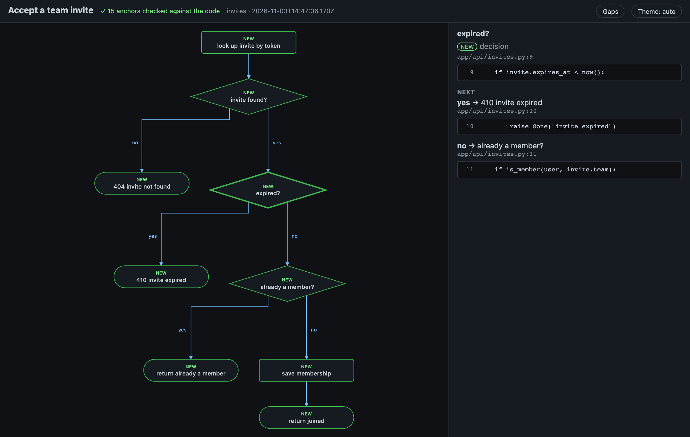

# Flows

A flow shows what the code actually does: its decisions, edge cases and outcomes, each step tied to a real line.

## When you get one

Ask "how does this work?", "what are the edge cases?" or "walk me through the logic" and the agent answers with a flow. It also draws one on its own when a change adds logic with 2 or more decisions or edge cases. Turn that off, or ask for flows only on request, with `defaults.flows` in [Configuration](configuration.md#all-keys).

## What it looks like

**Flow** _(key: + new  ~ changed  ? planned  ◇ decision  ⤷ shared step)_
```text
Accept a team invite
────────────────────
+look up invite by token
◇ +invite found?
├─ no  → +404 invite not found
└─ yes → ◇ +expired?
         ├─ yes → +410 invite expired
         └─ no  → ◇ +already a member?
                  ├─ yes → +return already a member
                  └─ no  → +save membership → +return joined

9 steps · 9 new · 0 changed · 0 planned · ✓ 15 anchors checked
gaps: did not check what happens when two requests accept the same invite at
      once
```

- `◇` marks a decision; its branches hang under it.
- `+` new, `~` changed, `?` planned; unmarked steps already existed.
- `⤷` marks a shared step: one reached from more than one place is printed once as its own block, and each place that reaches it shows `⤷ label`.

## Every step is tied to real code

Every step and branch names a `file:line` or quotes the line it comes from. When the line doesn't exist, the render fails and the agent has to fix it, so a flow can't describe code that isn't there. `✓ 15 anchors checked` in the footer counts those checks. For a commit that isn't checked out, `--at <rev>` reads the lines from that revision.

## Gaps

Only branches the agent saw in the code are drawn. Anything it didn't check, such as two requests racing for the same invite above, goes under `gaps` instead of being guessed.

## On the full page

On the full page, clicking a step shows the exact code behind it and each branch:



The rest of the page (panel, keys, themes, review notes) is described in [The full page](page.md).

## Flows in plans

A plan that changes existing behaviour gets a flow with two panes, Now and After plan: the branch the plan drops is red on the left, the planned one dashed on the right. See [Plans](plans.md).

## Related

- [Plans: Now and After](plans.md)
- [Why you can trust the diagram](trust.md)
- [Flow design](flow-design.md): how flows are specified, anchored and drawn
