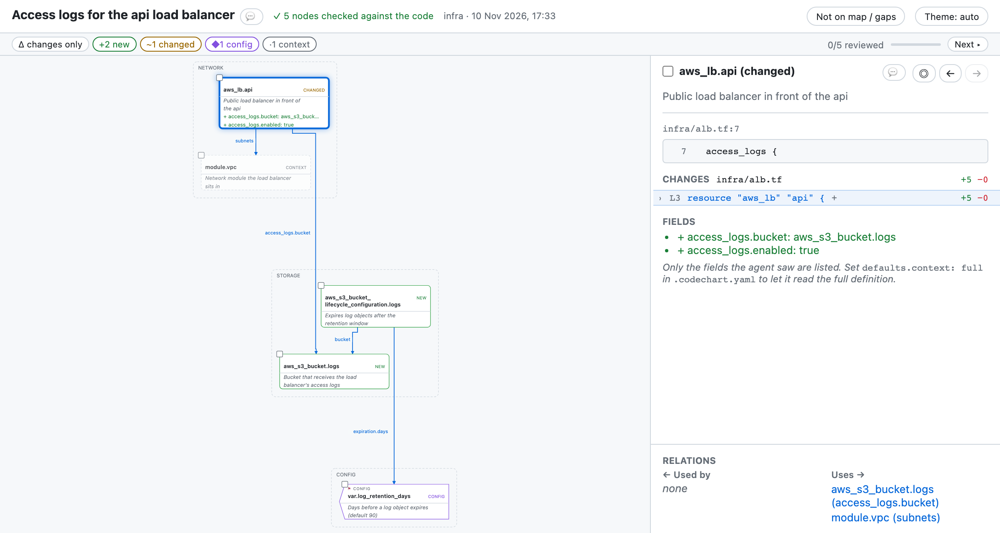

# Infrastructure maps

Terraform, OpenTofu, Helm, Kustomize and Kubernetes changes get a map of resources, modules and what they reference. It's built in: no rule to write.

## What it looks like

**Map** _(key: + new  ~ changed  - removed  ◆ config · unmarked = unchanged)_
```diff
storage
+ aws_s3_bucket.logs
+ aws_s3_bucket_lifecycle_c… ─bucket──────────▶ aws_s3_bucket.logs
                             ─expiration.days─▶ var.log_retention_days

network
~ aws_lb.api ─access_logs.bucket─▶ aws_s3_bucket.logs
             ─subnets────────────▶ module.vpc

config
◆ var.log_retention_days

5 nodes · 2 new · 1 changed · 1 config · ✓ 5 checked
gaps: terraform plan not run · module.vpc internals not read
```

- One node per resource, module or Kubernetes object, named as the code names it.
- Variables and values are config (`◆`).
- Arrows are labelled with the attribute that makes the reference.
- `terraform plan not run` is always listed under `gaps`: the map comes from the code, not from a plan run.

## On the full page

A changed resource shows its HCL diff and changed attributes. Every page has light, dark and auto themes; this one is light:



## Related

- [The full page](page.md)
- [Configuration](configuration.md): built-in rules and turning them off
- [Maps in pull requests](pr-maps.md)
