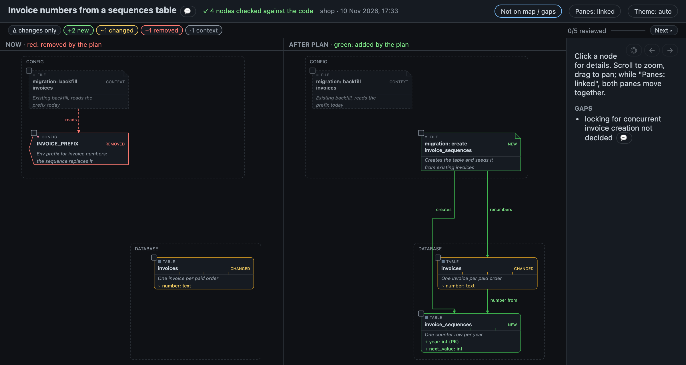
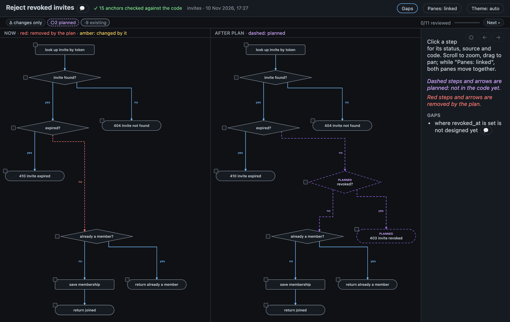
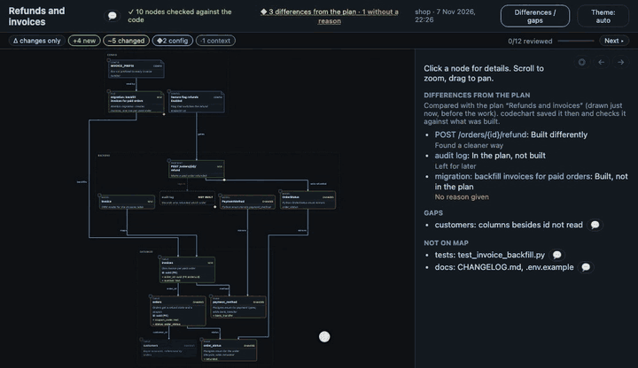

# Plans

Maps and flows work for plans too, so you can catch a wrong design before any code exists, and later see what was built differently.

## Now and After

A plan that touches existing code opens as two panes: **Now** (the code as it is) and **After plan**.

- Same positions in both panes, so you can compare them at a glance.
- What the plan removes is red in Now; what it adds is green (maps) or dashed (flows).
- The panes pan and zoom together. The header's *Panes: linked* toggle sets them free; your choice is remembered.
- Selecting a node selects it in both panes.

A plan that only adds things keeps a single map.



A plan that changes existing behaviour gets the same treatment as a flow: the dropped branch red on the left, the planned one dashed on the right.



## Plan vs built

When the work is done, codechart compares the change summary with the plan and shows what differs, with the agent's reason for each.

### How it works

- A plan rendered in a git repo is kept for a week, per branch, in the cache folder.
- The change summary drawn after it on the same branch is compared with that plan.
- Each difference is one of: planned and not built, built and not planned, or built differently.
- Each one shows the reason the agent gave. With no reason, it's flagged: `✗ … no reason given`.
- `--strict` makes the render fail on a difference without a reason.

### In the terminal

```text
Plan vs built (plan "Users can belong to teams", drawn 2h ago)
− audit log  in the plan, not built · why: left for later
    “You said the audit log can wait for the next release, so it was left out.”
✗ team_id index  built differently (path src/index.ts → src/team-index.ts) · no reason given
```

### On the page

- Nodes and steps that differ from the plan are marked with a `◆`.
- Each one's panel has a comparison box in plain words: what the plan said, what was built, and the agent's reason one click away.
- The info panel lists every difference.
- What was planned and not built is drawn as a dashed box labelled `NOT BUILT`.
- You can leave a review note on any of them: see [Review](review.md#on-the-page).



## Related

- [Flows](flows.md)
- [Why you can trust the diagram](trust.md)
- [CLI commands](cli.md): `render --strict`
