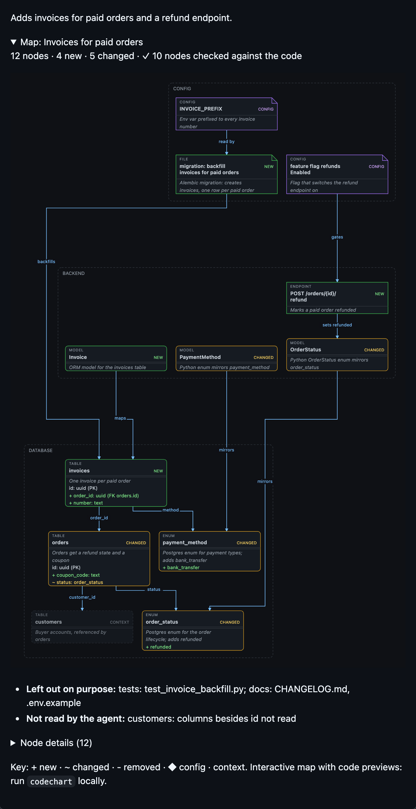

# Maps in pull requests and merge requests

Reviewers get the map too. With one CI file in the repo, the agent puts a collapsed **Map** section at the end of the PR or MR description, and CI redraws it on every push.



- **The image is the map from the HTML page** (same layout, kind tags, status colours and ✗ flags), following the reader's light or dark mode. Click it for full size.
- **Below it, the check in words:** ✗ claims grouped by reason with what each means, changed files not on the map, what the agent left out or didn't read, and the details of every node, collapsed.
- **Kept current:** on each push CI re-checks the map against the PR's diff and latest commit, so a file added later shows up as `✗ changed, not on map` until the agent updates the map.
- **No AI in CI, no tokens:** the map spec is stored hidden in the description; CI only re-checks and redraws it.

## Turn it on

Once per repo. It's off until you do, and nothing touches your repo without you saying yes. In the repo, ask your agent to *set up codechart PR maps*, or run:

```bash
codechart setup-pr-maps          # shows the file it would add and what runs, then asks
codechart setup-pr-maps --pr     # same, but opens a pull/merge request you merge to turn it on
```

It reads `origin` to tell GitHub from GitLab (`--host github|gitlab` when the URL says neither), shows the whole file and the token it uses, and writes only after you answer yes (`--yes` skips the question; agents use it after showing you the plan).

- **Without `--pr`** the file lands in your work tree, uncommitted, for you to review and commit.
- **With `--pr`** it opens a pull or merge request through `gh` or `glab` and leaves your work tree and branch alone: merge it to turn PR maps on, close it to say no. It's built on top of the remote's default branch and pushed as `codechart/pr-maps`. Nothing goes online before your yes: the file shown first is the template for your host, and only then does codechart fetch the default branch, check whether PR maps are already set up or a setup request exists, push and open the request, using your own git transport config (ssh command, URL rewrites, credential helper), so don't run it in a checkout you didn't clone yourself.
- **Pinned:** the CI job runs the codechart version you have installed, so an upgrade is a change you review.
- It never overwrites a file that isn't codechart's, and a second run says it's already set up. A second `--pr` run before that request is merged pushes nothing: it links the request already open (or closed) on `codechart/pr-maps`; delete that branch to open a new one.

### GitHub

Adds `.github/workflows/codechart.yml`. It uses the built-in token, no secret to add: `contents: write` to push the map image as a commit on `refs/codechart/pr-<number>` (not a branch), `pull-requests: write` to update the description. The image loads only for people who can see the repo. PRs from forks are skipped: their token can't edit the PR. A newer push cancels the run still drawing the older one.

### GitLab

Appends a `codechart-map` job to `.gitlab-ci.yml` (or creates it). The job runs in the `test` stage; if your file lists `stages:` without `test`, it gets the first stage listed (not `.pre` or `.post`), and a file listing only those two needs the setup by hand. Then add a masked CI/CD variable `CODECHART_GITLAB_TOKEN`: an access token with `api` scope from a user with at least the Developer role (GitLab's job token can't edit an MR or upload files). The command prints the link to create the token and the one to add the variable. Until the variable exists the job is skipped. The job has no fork check: it runs wherever the variable is set, so don't make the variable available to pipelines that run a fork's code. The image is a project upload, visible to project members. Merged-results pipelines and merge trains work.

### By hand

Copy `templates/github-workflow.yml`, or the job in `templates/gitlab-ci.yml`, from the installed package (`$(npm root -g)/codechart/templates/`) and replace `codechart@latest` with a version to pin it.

## How the map gets into a PR

- **The agent adds it.** When an agent with the skill writes a PR or MR description for a change it mapped, and the repo's CI mentions `pr-sync`, it renders the map with `--pr` and pastes the section at the end. In a repo without PR maps it pastes the plain map instead, and mentions once per conversation that PR maps exist.
- **You can ask for it:** "add the codechart map to the PR".
- **By hand:** `codechart render <spec> --since main --pr` prints the section (the image link starts as a placeholder; CI publishes the image on the next push).

Trivial changes get no map, so their PRs get no section.

## When CI runs and what it does

- **GitHub:** when a PR is opened, reopened, or gets new commits. Editing the description doesn't trigger it, so it never loops. **GitLab:** every merge request pipeline, when the token variable is set.
- **No section in the description:** it exits in a second and changes nothing. Adding the CI file doesn't put maps on every PR, only on the ones that have a section.
- **With a section:** it checks the stored map against the PR's diff at its latest commit, publishes the new image and replaces only the section; text you wrote around it stays.
- **It never rewrites the map itself.** If the code moves on, new ✗ flags appear until the agent renders the map again.
- **Skipped:** a run superseded by a newer push, a run where the spec was edited meanwhile, and repos whose config sets `defaults.output: none`.
- **Cost:** no AI and no tokens; one short CI job per push, mostly `npx` fetching codechart.

## Turn it off

- **One PR:** delete the Map section from its description.
- **The repo:** delete the CI file (or the GitLab job, or its variable). Agents go back to the plain map.

## Safety

`pr-sync` runs only in the CI job you add; it and `setup-pr-maps --pr` (after your yes) are the only commands that write outside your machine. Every network call is listed in [SECURITY.md](../SECURITY.md). Description text is escaped, the hidden spec can't break out of its comment, and only the section between its markers is replaced. Details in [SECURITY.md](../SECURITY.md).
