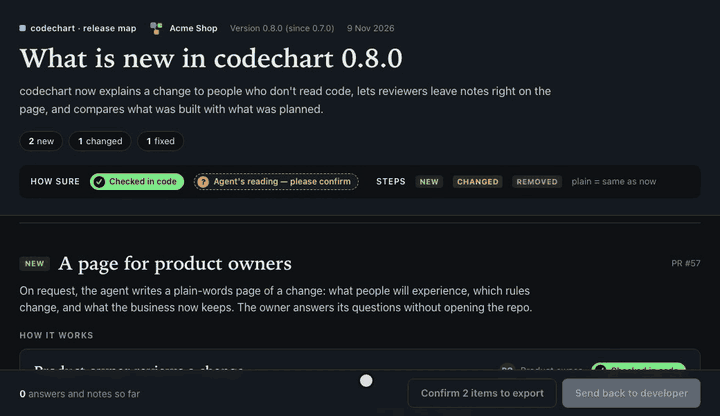

# Release map

One page for a whole release: a section per feature in plain words, for a product owner to review and then export as a PDF for sales and stakeholders. No code, file names or ids on the page, and the owner needs no access to the repo.



## When to use it

When a release is coming and someone who doesn't read code has to sign off on what it says, or you need release notes a salesperson can hand out. Your agent never makes one on its own, and it never goes into a PR description. When you prepare a release with it (version bump, changelog, release notes, tag), it offers one in a single line at the end of its reply, once per conversation. For a single change, use a [business map](business-map.md).

## How to ask

```text
> make a release map of what's in the next release
```

The agent runs `codechart release-context` (the changes merged since the last `v*` tag), groups them into features, writes a section for each, and replies with one line and a link to the page. Send that HTML file to the owner.

## What the owner sees

- **Header:** the product name, version, date, a short summary, and how many features are new, changed or fixed.
- **One section per feature** (up to 12): a *New*, *Changed* or *Fixed* badge, the pull request number if there is one, a short summary, then as many of these as apply:
  - **How it works:** journeys, steps today and steps after (up to 4);
  - **Rules:** before and after, with exceptions (up to 6);
  - **Information kept:** what the business now saves and why (up to 4);
  - **Questions for you:** only the owner can answer (up to 4).
  A small fix can be just a summary.

Items carry the same tags as on the business map: **Checked in code**, or **Agent's reading, please confirm** with *Yes, that's right* and *No*. The owner can add a note to any item and type an answer under a question. Items have no technical links: the release page is not tied to a tech map.

## Export as a PDF

The bottom bar has **Export release** next to **Send back to developer**. It stays disabled until every *Agent's reading* item has a Yes or a No, and says how many are left (*Confirm 3 items to export*). Then it opens the browser's print window: choose *Save as PDF*.

The printed version has:

- a cover with the logo, product name, version, date and summary;
- the features one after another, a feature's heading never left alone at the bottom of a page and a card never split, with page numbers where the browser supports them (Chrome does; Safari may not);
- light colours whatever theme the page is in.

It leaves out the questions, notes, Yes/No buttons, trust tags, the legend, the bottom bar, and every item the owner answered **No**. A feature with nothing left of a kind loses that heading too.

## Product name and logo

In the repo's `.codechart.yaml`:

```yaml
release:
  product: Acme Shop
  logo: docs/logo.svg
```

Without `product` the cover uses the repo name. The logo is a repo-relative `.svg` or `.png` of at most 200 KB; it is embedded in the page, which still loads nothing from the internet. A logo that is missing, too big, the wrong type, or outside the repo (an absolute path, `..`, or a symlink that leaves the repo) is skipped with a warning on stderr; the page is still written. See [Configuration](configuration.md).

## Sending it back

The same as the business map: **Send back to developer** copies the answers, verdicts and notes, the owner pastes them to the developer, and the agent runs `codechart feedback --import --take`. Each note names its item (`Rule "Manager approval" [R1]`) and has no tech links. The page's record is kept 30 days. Release pages are saved with the business pages: `codechart feedback --change <title>` finds either.

## What is checked

Before the page is drawn:

- the version looks like a version, the date is a real `YYYY-MM-DD` date, a section's `change` is `new`, `changed` or `fixed`, and ids are unique across the whole page;
- every sentence passes the same plain-words check as a business map: no code, file name or path, web address, setting name, secret or technical id.

Your agent is told to re-read the code behind every *Checked in code* item before it draws the page. A wrong sentence can pass every check, which is why the owner confirms the rest. See [Why you can trust the diagram](trust.md#business-maps).

## Limits

- HTML only: no terminal or PR version. `--pr` and `--tech` are refused.
- The PDF comes from the browser's print dialog, so page breaks and numbering follow the browser.
- Sharing the HTML file: see [Business map](business-map.md#limits).

## Related

- [Business map](business-map.md)
- [Review](review.md#notes-from-a-product-owner)
- [CLI commands](cli.md)
