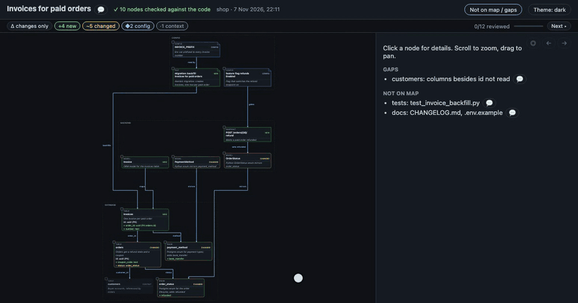

# Review

Leave notes on a map, on the page or in your terminal, and hand them to your agent in one go.

Notes come in three kinds: **comment**, **question** and **delete this**. Both ways of reviewing end in the same list, which your agent reads as numbered notes, each with its file, line and the code it points at.

## On the page

### Adding notes

- **A node:** 💬 in its panel title, or `c` with the node selected.
- **A diff line:** hover the line number and click `+`.
- **Anything else:** arrows, plan-vs-built boxes, gaps, *Not on map* items and the title take notes too. An arrow's or the title's note opens in a small floating box.
- Pick the kind (Comment, Question or Delete) and save. Each kind has its own colour, and a node shows how many notes it has.

### Sending them to your agent

1. Click **Finish review (N)** at the top right.
2. Click **Copy and close**: your notes are copied as plain text with a short closing line.
3. Paste that into your agent chat. The agent saves them with any terminal notes and reads them back.

Or run `codechart feedback --import` yourself: it reads the copied text from the clipboard and adds the notes to the same list. Pasting twice adds nothing new.

A very long review is copied in parts: the popup says how many notes the message holds, and you click *Finish review* again for the rest.

### What stays where

- Notes stay in your browser, per page, until you send them. A redrawn map starts a fresh list.
- Sent notes stay on the page, dimmed. Edit one and it counts as unsent again.
- The page never sends anything itself: the hand-off is your paste.

## In the terminal

### Writing notes

1. Run `codechart review`. The newest map of your branch opens in your `$EDITOR` as a coloured diff, one heading per node.
2. Under a node or a diff line, write a note on its own line:
   - `> text` for a comment
   - `>? text` for a question
   - `>del text` for "delete this"
3. Save and quit. Quit without saving to cancel.

To add one note without the editor: `codechart comment <node>[:<path>:<line>] <text>`.

It works for maps shown only in the terminal too.

### Sending them to your agent

Tell your agent "review done". It runs `codechart feedback --take` and gets your notes as numbered markdown, each with its file, line and the code it points at. Those notes are then marked sent.

### When the map is redrawn

- Notes stay with the map when your agent redraws it on the same branch with the same title.
- A note turns *outdated* when its node's diff has changed, so it never points at code you didn't see.
- If the code changed since the map was drawn, `codechart review` warns first.

Every command and option, and the exact note format: [CLI: Console review](cli.md#console-review).

## Notes from a product owner

A [business map](business-map.md) has its own page and its own kinds of note. The owner types **answers** to questions, presses **Yes, that's right** or **No** on the agent's readings, and adds comments; *Send back to developer* copies the lot as text. It travels the same way as page notes: paste it to your agent, which runs `codechart feedback --import --take` and reads each note under its journey, rule or saved item, with the technical boxes it links to (`Answer`, `Confirmed`, `Rejected`, `Comment`).

## Related

- [The full page](page.md)
- [CLI commands](cli.md)
